<!--
  Assets live in ./assets (SVG panels). Upload that folder to the same repo as this README.
  Colors: teal #1E4B44 | parchment #EFEADB | border #A9A48F | lime #8DB04A | gold #E0B04F
-->

<!-- ROW 1: HERO + CONTACT -->
<table>
<tr>
<td valign="top">
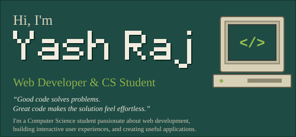
</td>
<td valign="top">
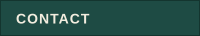 
 
<a href="https://github.com/yash-raj-01">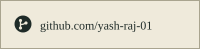</a> 
<a href="https://www.linkedin.com/in/yash-raj-23b921358/">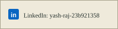</a> 

<!-- Phone intentionally omitted from the public README. -->
</td>
</tr>
</table>

<!-- ROW 2: EDUCATION + SKILLS | FEATURED PROJECTS | GITHUB STATS -->
<table>
<tr>
<td valign="top">
 
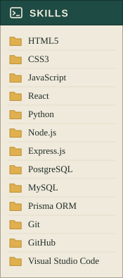
</td>
<td valign="top">
 

<a href="https://github.com/yash-raj-01/Open-Library-Book-Finder">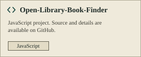</a> 
<a href="https://github.com/yash-raj-01/music">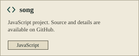</a> 
<a href="https://github.com/hartej46/CultStory">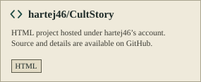</a> 
<a href="https://github.com/yash-raj-01?tab=repositories">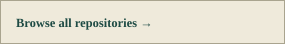</a>
<!--
  ADD A PROJECT: copy assets/project-snw.svg, edit the title, description lines and chips, then add:
   
-->
</td>
<td valign="top">
 
  
  
 
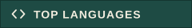 

</td>
</tr>
</table>

<!-- ROW 3: ACTIVITY -->
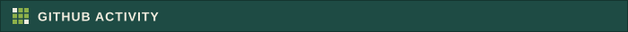 
 

<!-- ROW 4: TOP REPOSITORIES | TOOLS | ACHIEVEMENTS -->
<table>
<tr>
<td valign="top">
 
 
 

 
</td>
<td valign="top">
 

</td>
<td valign="top">
 

 
<a href="https://github.com/yash-raj-01?tab=achievements">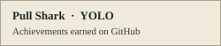</a>
</td>
</tr>
</table>

<!-- TASKBAR -->

# yash-raj-01
# yash-raj-01
